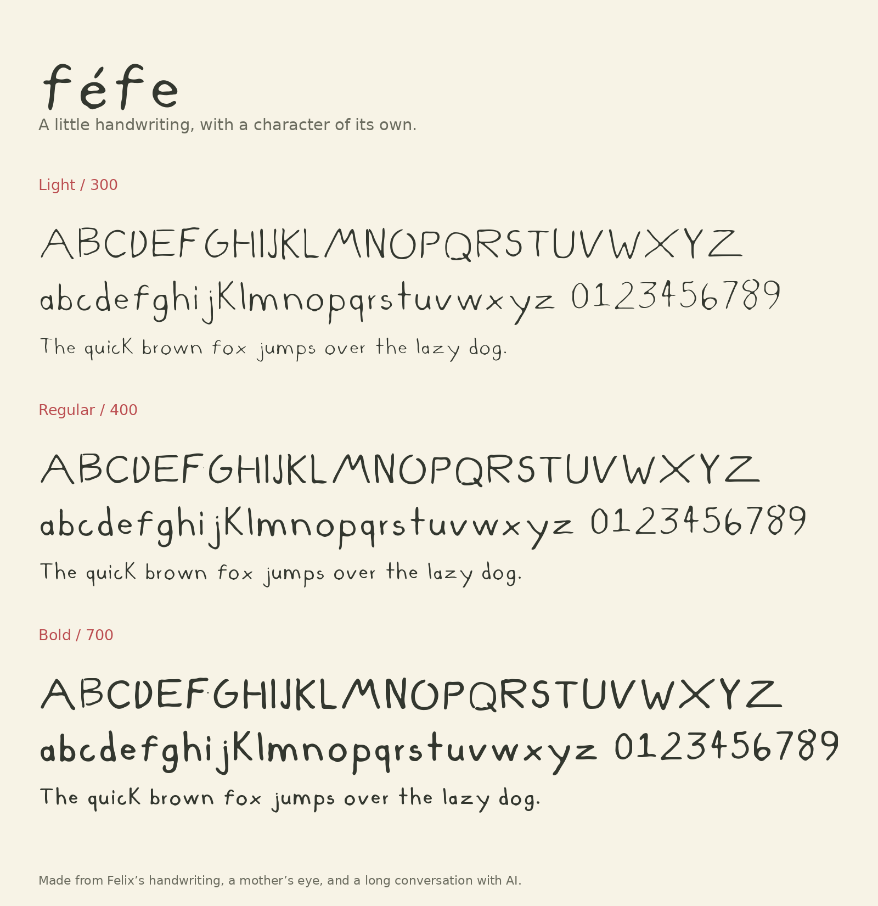

# féfe

### A little handwriting, with a character of its own.

féfe began with a parent noticing something worth exploring: the way her child writes.

Felix filled five sheets with letters, numbers, punctuation, and a few sentences about music, chess, and small things in nature. His handwriting had its own ideas. The D and O didn’t quite close. The lowercase k stood as tall as the capital K. The letters leaned, curved, and left room to breathe.

Turning those pencil marks into a font took more care than we expected.

The first versions mistook the roughness of a scan for the texture of handwriting. Soft pencil edges became little cuts and corners. Printed baselines found their way into the letters. We learned that making handwriting digital means observing and deciding, again and again, what belongs to the writer and what belongs to the scanner.

We went back to the originals. We compared letters across words. We removed one stray stroke from N, while keeping the open D and O. When the baseline kept stealing the bottoms of rounded letters, Mom opened the scanned image herself and carefully erased the line with a brush tool.

Sometimes craftsmanship looks like that.

féfe now comes in three weights: Light, Regular, and Bold. Each carries the same small gestures, with a little more or less presence.

Its first poster features a mantis shrimp, dressed in vermilion and cream, inspired by an old French newspaper cover. An unlikely beginning for a typeface, perhaps. But a good home for a child’s curiosity.

Made from Felix’s handwriting, a mother’s eye, and a long conversation with AI.

## The typeface

## Download & install

[Download the full font family (v4.2)](Fefe-Font-Family-v4.2.zip)

Or download the individual fonts: [Light](Fefe-Light.ttf), [Regular](Fefe-Regular.ttf), [Bold](Fefe-Bold.ttf).

Unzip the package, open the TTF files and install them with your font manager. If you have an earlier version of féfe, disable it first and restart your design app after installing.

**Three weights:** Light 300 · Regular 400 · Bold 700.
